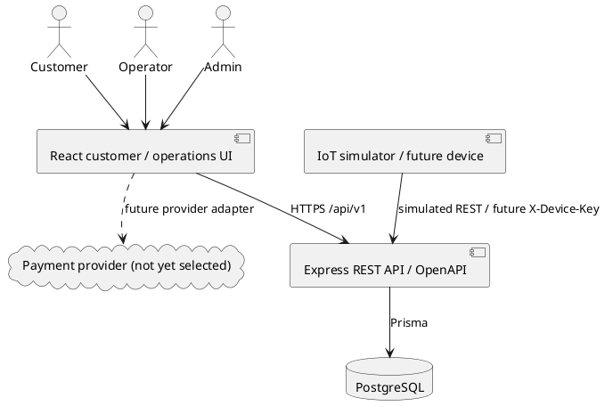
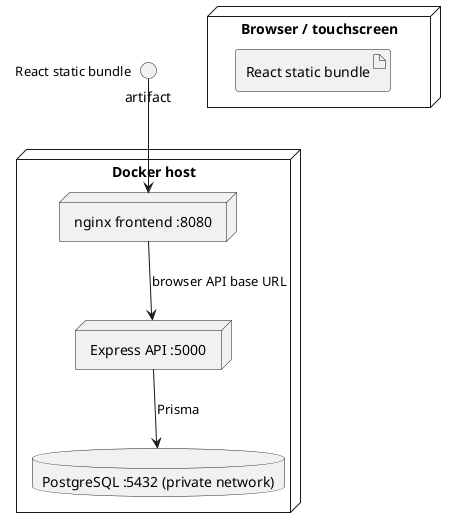
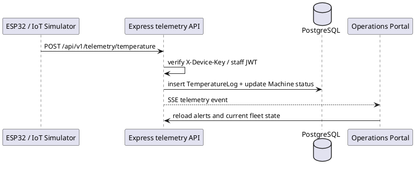

# FreshVend — Kiến trúc và thiết kế

## Thành phần

## Triển khai local và Docker

Frontend browser cần `FRONTEND_API_BASE_URL` trỏ tới API mà máy người dùng truy cập được; hostname `api` chỉ dùng bên trong Docker network, không dùng làm URL trình duyệt.

## Mô hình dữ liệu

ERD triển khai nằm trong `prisma/schema.prisma`: `Machine` có nhiều `Column`, `TemperatureLog`, `RestockEvent`, `MachineAction` và `Transaction`; `Column` trỏ tới `Product` và nhiều `InventoryBatch`; `Transaction` gắn khách hàng tùy chọn; `MachineAction` lưu người thao tác xóa lỗi. Migration quản lý thay đổi schema.

## Luồng telemetry

SSE cần JWT Bearer và chỉ mở cho Admin/Operator. REST polling 30 giây là đường dự phòng. Muốn khớp tuyệt đối yêu cầu WebSocket, thay lớp stream bằng WebSocket có cùng auth/contract.

## Hợp đồng API chính

| Chức năng | Endpoint |
|---|---|
| Đăng ký/đăng nhập | `POST /api/v1/auth/register`, `POST /api/v1/auth/login` |
| Danh mục khách | `GET /api/v1/products/catalog` |
| Tạo giao dịch | `POST /api/v1/transactions` |
| Mô phỏng thanh toán/nhả hàng | `POST /api/v1/transactions/:id/simulate-payment`, `/simulate-dispense` (development; release production requires explicit `SIMULATION_MODE=true`) |
| Máy/kho/restock/log | `/api/v1/machines`, `/columns`, `/restock`, `/temperature-logs`, `/restock-events` |
| Telemetry | `POST /api/v1/telemetry/temperature` |
| Tổng quan/cảnh báo/export | `/api/v1/operations/summary` (Admin), `/alerts` (staff), `/sales.csv` (Admin), `/stream` (staff) |
| Tài khoản/role | `/api/v1/users` (Admin) |
| API contract | `/api-docs`, `/api-docs.json` |

## Bảo mật

- Password hash bằng bcrypt; access token JWT; role lấy lại từ DB để đổi quyền có hiệu lực.
- Device secret lưu hash SHA-256; so sánh an toàn thời gian.
- Doanh thu và CSV chỉ trả cho Admin; Operator nhận transaction không có trường amount.
- Cấu hình production phải dùng TLS reverse proxy, secrets riêng và giới hạn `CORS_ORIGINS`.
