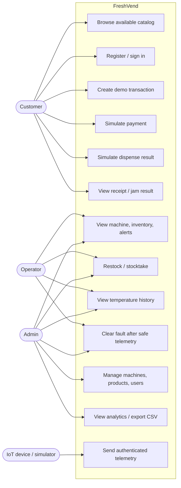
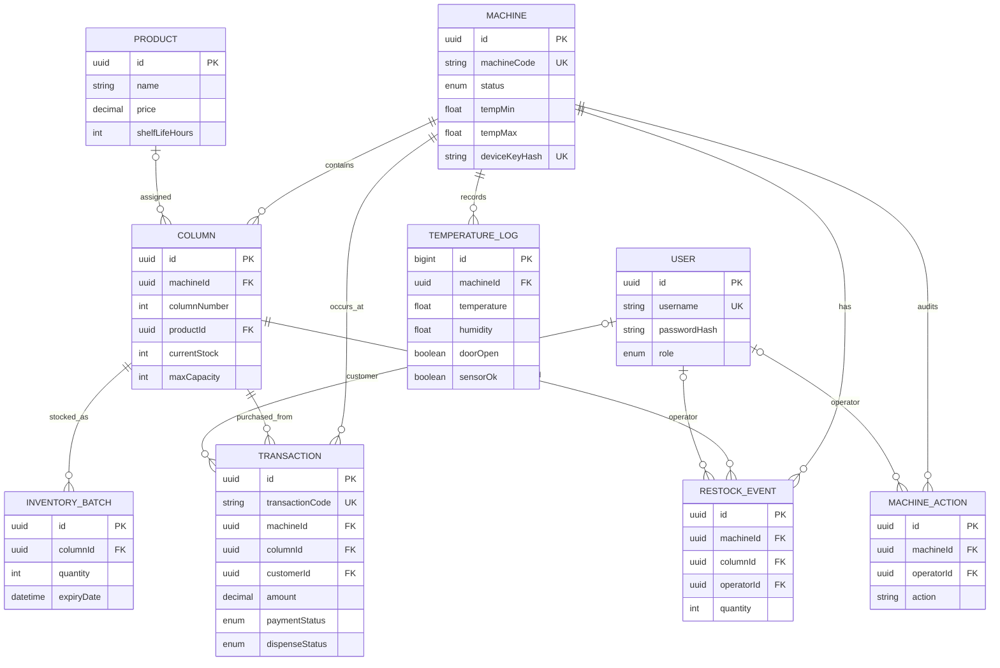
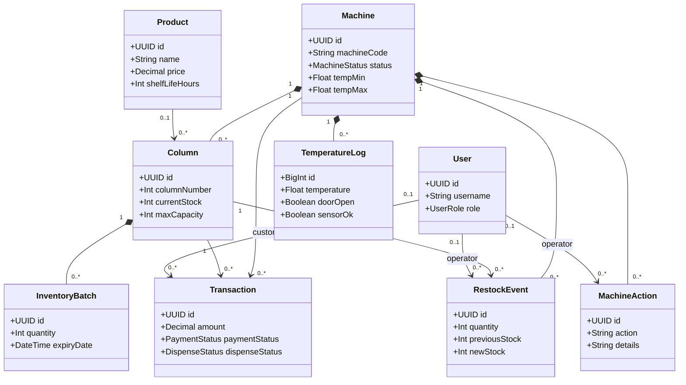
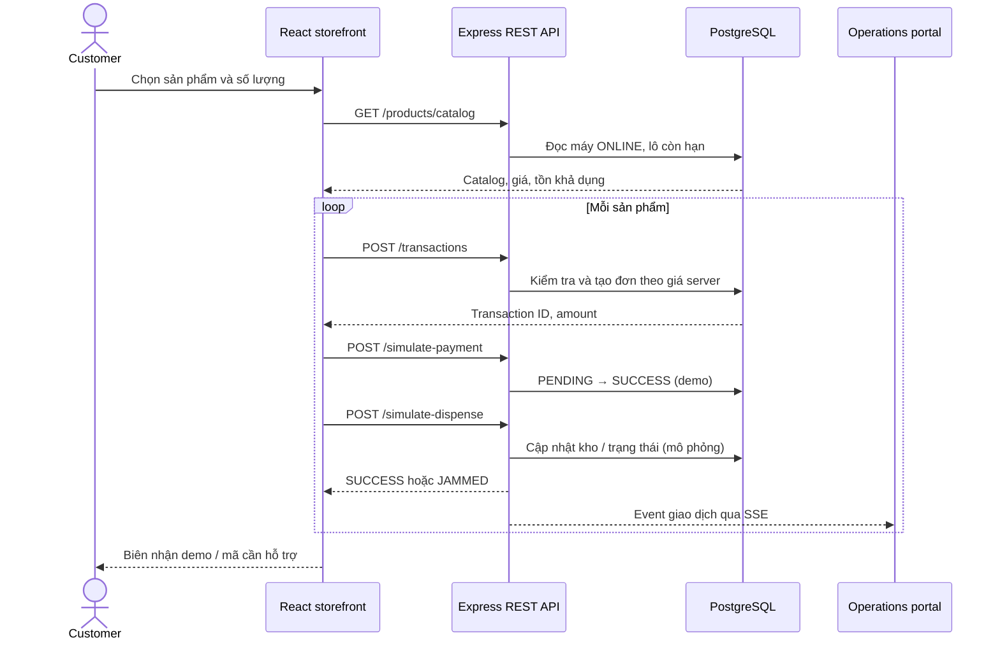
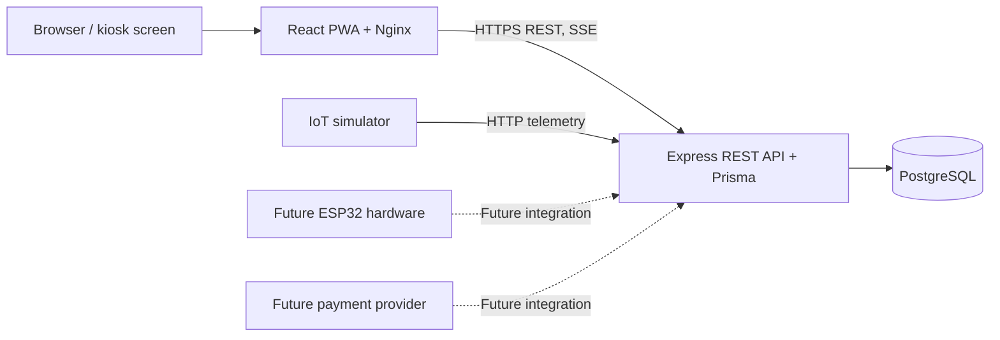

# Sơ đồ FreshVend

Các sơ đồ Mermaid dưới đây hiển thị trực tiếp trên GitHub/GitLab hỗ trợ Mermaid. PlantUML source đầy đủ nằm trong [`docs/uml/`](uml/README.md). Các sơ đồ mô tả bản phần mềm demo 1.0.0.

## Use-case

## ERD

## Class diagram

## Sequence: checkout demo

## Component và deployment

Thiết bị thật và nhà cung cấp thanh toán là các tích hợp tương lai; diagram không biểu thị chúng đã được triển khai.
